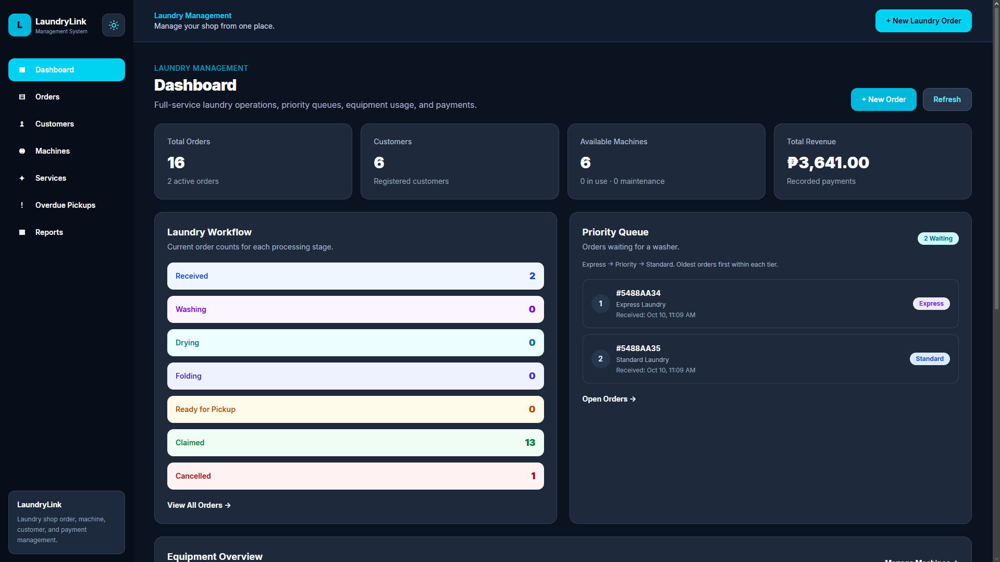

# LaundryLink — Laundry Management System

A full-stack laundry management application built with **React, TypeScript, Tailwind CSS, Node.js, Express, and MongoDB Atlas**.

## 1. Project Overview

LaundryLink is a web-based laundry management system designed to help laundry businesses organize daily operations through a centralized platform.

The application manages customer records, laundry services, orders, washing and drying machines, payments, and operational reports.

Unlike a basic record-management system, LaundryLink performs real data processing, including automated pricing, bulk and loyalty discounts, payment balance calculations, machine availability checking, priority-based order scheduling, and overdue monitoring.

**Course:** CTADWEBL — Advanced Web Programming
**Project Type:** Final Project
**Repository:** https://github.com/carinoirvin12-sudo/laundrylink

## 2. Technology Stack

### Frontend
- React with Vite
- TypeScript
- Tailwind CSS
- React Router
- Axios
- React Hook Form
- Zod and `@hookform/resolvers`

### Backend
- Node.js
- Express.js
- MongoDB Atlas
- Mongoose
- CORS
- Environment variables with dotenv

### Development Tools
- Visual Studio Code
- Git and GitHub
- npm
- Browser Developer Tools

## 3. Main Features

### Landing Page
A dedicated introduction to LaundryLink with a system overview, feature highlights, and navigation to the management dashboard.

### Dashboard
Displays operational information such as active orders, laundry status counts, machine availability, revenue, overdue pickups, and priority queue information.

### Customer Management
Supports customer creation, viewing, updating, and eligible deletion. Includes customer details and order history.

### Laundry Order Management
Supports order creation, viewing, updating, searching, filtering, pagination, and controlled deletion.

The Orders page displays **five orders per page**, with Previous/Next navigation and status filters.

### Point-of-Sale Order Creation
Allows staff to create laundry orders for new or existing customers, preview pricing, and save transactions.

### Machine Management
Manages washers and dryers separately, including their capacity, maintenance state, and computed availability.

The system prevents machine conflicts through backend assignment rules.

### Laundry Priority Queue
Organizes waiting orders using this priority:

1. Express Laundry
2. Priority Laundry
3. Standard Laundry

Orders of the same priority are processed in first-in, first-out order.

Machine operations already in progress are not interrupted.

### Payment Management
Supports cash, GCash, and bank payment records.

Customers may pay partially or in full, but an order must be fully paid before it can be claimed.

### Discounts
Automatically determines eligibility for bulk and loyalty discounts and calculates the final order price.

### Reports and Statistics
Provides revenue information, order counts, operational summaries, and overdue pickup monitoring.

## 4. Laundry Services

| Service | Price per kg | Minimum charge | Turnaround |
|---|---:|---:|---:|
| Standard Laundry | ₱50.00 | ₱50.00 | 24 hours |
| Priority Laundry | ₱65.00 | ₱65.00 | 12 hours |
| Express Laundry | ₱80.00 | ₱80.00 | 6 hours |

All three services include **Wash + Dry + Fold**.

These are the project's configured demonstration packages. Pricing and turnaround values are stored in the database and managed through the Services page.

## 5. Business Rules and Data Processing

### Weight and Machine Capacity
- Each laundry order must weigh between **1 kg and 15 kg**.
- The configured demonstration machines have a maximum capacity of 15 kg.
- Loads exceeding 15 kg must be divided into separate orders.
- Washer and dryer assignments occur during their corresponding processing stages.

### Bulk Discount
A **5% bulk discount** applies to orders weighing **10 kg or more**.

### Loyalty Discount
A **5% loyalty discount** applies when a customer has at least **five Claimed orders** before creating a new order.

### Combined Discounts
Bulk and loyalty discounts are additive when both conditions are met.

| Eligibility | Discount |
|---|---:|
| Neither condition | 0% |
| Bulk only | 5% |
| Loyalty only | 5% |
| Bulk and loyalty | 10% |

**Example: Loyal customer purchasing 10 kg of Standard Laundry**

| Calculation | Amount |
|---|---:|
| Subtotal: 10 × ₱50 | ₱500.00 |
| Bulk discount: 5% | −₱25.00 |
| Loyalty discount: 5% | −₱25.00 |
| Final total | **₱450.00** |

The discount amount is deducted from the original subtotal.

### Order Workflow

Each order follows this lifecycle:

**Received → Washing → Drying → Folding → Ready → Claimed**

| Status | Description |
|---|---|
| Received | Order accepted and waiting for a washer |
| Washing | Assigned washer is occupied |
| Drying | Washer is released and assigned dryer is occupied |
| Folding | Dryer is released and laundry is being prepared |
| Ready | Laundry is ready for customer pickup |
| Claimed | Customer has collected the fully paid order |
| Cancelled | Eligible unpaid order has been cancelled |

### Machine Availability
- Machines must be active and have sufficient capacity.
- A washer is occupied while its assigned order is Washing.
- A dryer is occupied while its assigned order is Drying.
- Moving an order to Drying releases its washer.
- Moving an order to Folding releases its dryer.
- Machine availability is derived from order assignments rather than manually marked as In Use.

### Payments and Restrictions
- Supports partial and full payments.
- Payment amounts must be positive and cannot exceed the remaining balance.
- Payments cannot be recorded for cancelled orders.
- Orders cannot be claimed until fully paid.
- Cancellation is restricted to eligible unpaid Received orders.
- Deletion is restricted to eligible Received or Cancelled orders without recorded payments.

### Due Dates and Overdue Orders
Due dates are calculated using the selected service's turnaround time. The system identifies overdue orders and supports overdue pickup monitoring.

## 6. Application Pages

| Page | Route | Purpose |
|---|---|---|
| Landing Page | `/` | System introduction |
| Dashboard | `/dashboard` | Operational overview |
| Orders | `/orders` | Search, filter, and paginate orders |
| New Order | `/orders/new` | Create an order |
| Order Details | `/orders/:id` | Order workflow and payments |
| Customers | `/customers` | Customer management |
| Customer Details | `/customers/:id` | Customer information and history |
| Machines | `/machines` | Machine management |
| Services | `/services` | Service management |
| Overdue Pickups | `/overdue` | Overdue monitoring |
| Reports | `/reports` | Revenue and operational reports |

The frontend contains **11 routed pages**, including the landing page.

## 7. Database Design

LaundryLink uses five main Mongoose models:

| Model | Purpose | Relationships |
|---|---|---|
| Customer | Stores customer information | Referenced by Order |
| Service | Stores laundry packages and pricing | Referenced by Order |
| Machine | Stores washer and dryer information | Referenced by Order |
| Order | Stores laundry transactions and workflow | References Customer, Service, and Machine |
| Payment | Stores payment transactions | References Order |

### Relationships

- One customer can have multiple orders.
- One service can be used by multiple orders.
- An order can reference a washer and a dryer.
- One order can have multiple payment transactions.

### Schema Validation

Mongoose models implement relevant validation rules, including:

- Required fields
- Minimum and maximum values
- Enumerated values
- Default values
- Unique customer phone numbers
- Unique machine and service names
- Date and timestamp fields
- Monetary values limited to two decimal places

## 8. Project Structure

```text
laundrylink/
├── backend/
│   ├── src/
│   │   ├── config/
│   │   ├── controllers/
│   │   ├── middleware/
│   │   ├── models/
│   │   ├── routes/
│   │   ├── seed/
│   │   ├── services/
│   │   ├── utils/
│   │   ├── app.js
│   │   └── server.js
│   ├── .env.example
│   └── package.json
├── frontend/
│   ├── src/
│   │   ├── hooks/
│   │   ├── layouts/
│   │   ├── pages/
│   │   ├── schemas/
│   │   ├── services/
│   │   └── App.tsx
│   ├── .env.example
│   └── package.json
└── README.md
```

## 9. Installation and Setup

### Prerequisites
- Node.js and npm
- MongoDB Atlas database
- Git
- A code editor such as Visual Studio Code

### Clone the Repository

```bash
git clone https://github.com/carinoirvin12-sudo/laundrylink.git
cd laundrylink
```

### Backend Setup

```bash
cd backend
npm install
```

Create a `.env` file inside the `backend` directory.

```env
PORT=5000
MONGO_URI=your_mongodb_atlas_connection_string
```

Replace the placeholder with your own MongoDB Atlas connection string.

Start the backend:

```bash
npm run dev
```

The backend runs on:

`http://localhost:5000`

API endpoints use the `/api` prefix.

### Frontend Setup

Open another terminal:

```bash
cd frontend
npm install
```

Create a `.env` file in the `frontend` directory:

```env
VITE_API_BASE_URL=http://localhost:5000/api
```

Start the frontend:

```bash
npm run dev
```

Open:

`http://localhost:5173`

If Vite selects another port, use the URL displayed in the terminal.

### Initial Demonstration Data

For a demonstration, configure these records through the application:

**Services**
- Standard Laundry — ₱50/kg, 24 hours
- Priority Laundry — ₱65/kg, 12 hours
- Express Laundry — ₱80/kg, 6 hours

**Machines**
- Washer 01 — Washer, 15 kg, Active
- Washer 02 — Washer, 15 kg, Active
- Dryer 01 — Dryer, 15 kg, Active
- Dryer 02 — Dryer, 15 kg, Active

Add sample customers and orders before the final presentation.

## 10. REST API Documentation

The Express backend uses JSON requests and responses.

### Customers

| Method | Endpoint | Purpose |
|---|---|---|
| GET | `/api/customers` | List customers |
| POST | `/api/customers` | Create customer |
| GET | `/api/customers/:id/summary` | Customer summary |
| GET | `/api/customers/:id` | Customer details |
| PUT | `/api/customers/:id` | Update customer |
| DELETE | `/api/customers/:id` | Delete eligible customer |

### Services

| Method | Endpoint | Purpose |
|---|---|---|
| GET | `/api/services` | List services |
| POST | `/api/services` | Create service |
| GET | `/api/services/:id` | Service details |
| PUT | `/api/services/:id` | Update service |
| DELETE | `/api/services/:id` | Delete eligible service |

### Machines

| Method | Endpoint | Purpose |
|---|---|---|
| GET | `/api/machines` | List machines |
| GET | `/api/machines/availability` | Calculate machine availability |
| POST | `/api/machines` | Create machine |
| GET | `/api/machines/:id` | Machine details |
| PUT | `/api/machines/:id` | Update machine |
| DELETE | `/api/machines/:id` | Delete eligible machine |

### Orders

| Method | Endpoint | Purpose |
|---|---|---|
| GET | `/api/orders` | List orders |
| POST | `/api/orders/pos` | Point-of-sale order creation |
| POST | `/api/orders` | Create an order |
| POST | `/api/orders/quote` | Calculate order quotation |
| GET | `/api/orders/queue` | Priority queue |
| GET | `/api/orders/overdue` | Overdue orders |
| GET | `/api/orders/search` | Search and filter |
| GET | `/api/orders/:id/balance` | Payment balance |
| PATCH | `/api/orders/:id/status` | Change order status |
| GET | `/api/orders/:id` | Order details |
| PUT | `/api/orders/:id` | Update eligible order |
| DELETE | `/api/orders/:id` | Delete eligible order |

### Payments

| Method | Endpoint | Purpose |
|---|---|---|
| GET | `/api/payments` | List payments |
| POST | `/api/payments` | Record payment |
| GET | `/api/payments/:id` | Payment details |
| DELETE | `/api/payments/:id` | Delete payment where permitted |

### Statistics

| Method | Endpoint | Purpose |
|---|---|---|
| GET | `/api/stats/summary` | Operational dashboard statistics |
| GET | `/api/stats/priority-queue` | Priority queue summary |
| GET | `/api/stats/revenue` | Revenue reporting |

**Total: 36 declared REST API endpoints.**

The endpoint table describes declared routes; actual request parameters, update restrictions, and response structures are defined by the corresponding route handlers. The Statistics priority-queue path should be confirmed against the multiline declaration in `statsRoutes.js`.

## 11. API Request and Response Examples

The following examples use demonstration data. Object IDs and timestamps vary per database.

### Example A — Create Customer

**Request**

```http
POST /api/customers
Content-Type: application/json
```

```json
{
  "fullName": "Juan Dela Cruz",
  "phone": "09123456789",
  "address": "Clark, Pampanga"
}
```

**Sample Response — HTTP 201 Created**

```json
{
  "fullName": "Juan Dela Cruz",
  "phone": "09123456789",
  "address": "Clark, Pampanga",
  "_id": "507f1f77bcf86cd799439011",
  "createdAt": "2026-10-09T11:35:16.356Z",
  "updatedAt": "2026-10-09T11:35:16.356Z",
  "__v": 0
}
```

### Example B — Create Laundry Order

**Request**

```http
POST /api/orders
Content-Type: application/json
```

```json
{
  "customer": "507f1f77bcf86cd799439011",
  "service": "507f191e810c19729de860ea",
  "weightKg": 5,
  "notes": "Handle with care"
}
```

This example illustrates order creation for an existing customer. The specified customer and service IDs must already exist.

A new order begins in the **Received** stage without an assigned washer or dryer. Pricing and due date depend on the selected service and applicable discounts.

### Example C — Record Partial Payment

**Request**

```http
POST /api/payments
Content-Type: application/json
```

```json
{
  "order": "507f1f77bcf86cd799439012",
  "amount": 100,
  "method": "cash",
  "remarks": "Partial payment"
}
```

For an order worth ₱250 with no previous payments, the resulting balance should be:

```json
{
  "totalPrice": 250,
  "totalPaid": 100,
  "remainingBalance": 150
}
```

*The balance object above illustrates the calculation; the exact API response structure depends on the balance route.*

### Example D — Invalid Customer Creation

**Request**

```http
POST /api/customers
Content-Type: application/json
```

```json
{}
```

**Response — HTTP 400 Bad Request**

```json
{
  "message": "Full name is required"
}
```

### Example E — Unknown API Endpoint

**Request**

```http
GET /api/does-not-exist
```

**Response — HTTP 404 Not Found**

```json
{
  "message": "Route not found"
}
```

### Example F — Nonexistent Order

**Request**

```http
GET /api/orders/000000000000000000000000
```

**Response — HTTP 404 Not Found**

```json
{
  "message": "Order not found"
}
```

### Example G — Invalid Object ID

**Request**

```http
GET /api/orders/invalid-id
```

**Response — HTTP 400 Bad Request**

```json
{
  "message": "Invalid ID or value"
}
```

## 12. Backend Architecture and Error Handling

The backend is organized into separate route, model, middleware, and supporting folders.

The request flow is:

**React Frontend → Axios → Express REST API → Mongoose → MongoDB Atlas**

The Express application includes:
- CORS middleware
- JSON request parsing
- Custom HTTP request logging
- Organized route mounting
- JSON 404 catch-all
- Global error-handling middleware
- Mongoose validation error handling
- Invalid Object ID handling
- Duplicate key error handling

Sensitive internal error details are not returned to clients for unexpected server errors.

## 13. Frontend Architecture and Validation

The frontend uses React Router for navigation, a shared Axios configuration for backend communication, and Tailwind CSS for responsive styling.

Forms use **React Hook Form, Zod, and Zod Resolver** for structured validation.

Form validation includes:
- Required fields
- Numeric limits
- Input formats
- Per-field error messages
- Submit handling

A custom `useDebounce` hook is used for delayed customer searching.

Order listing features include:
- Status filtering
- Text searching
- Priority-aware sorting
- Five-record pagination
- Previous/Next navigation

## 14. Testing and Validation

The following functionality has been manually tested during development:

| Test | Observed Result |
|---|---|
| Create and claim an order | Passed |
| Washing-to-drying transition | Passed |
| Release washer during drying | Passed |
| Release dryer during folding | Passed |
| Prevent assignment of occupied washers | Passed |
| Prevent assignment of occupied dryers | Passed |
| Priority scheduling | Passed |
| Partial payment | Passed |
| Full payment before claiming | Passed |
| Reject overpayment | Passed |
| Reject zero and negative payments | Passed |
| Cancel eligible unpaid order | Passed |
| Delete eligible cancelled order | Passed |
| Protect paid completed orders | Passed |
| Bulk discount calculation | Passed |
| Loyalty discount calculation | Passed |
| Combined discount calculation | Passed |
| Orders pagination and filtering | Passed |
| Frontend production build | Passed |
| Backend syntax checks | Passed |
| HTTP 200 GET response | Passed |
| HTTP 201 customer creation | Passed |
| HTTP 400 validation response | Passed |
| HTTP 404 missing route and record | Passed |

These results reflect manual testing of selected cases. They are not a substitute for complete automated integration, concurrency, security, or performance testing.

### Frontend Build

```bash
cd frontend
npm run build
```

### Backend Syntax Check

```bash
cd backend
node --check src/app.js
node --check src/models/Order.js
node --check src/routes/orderRoutes.js
node --check src/routes/machineRoutes.js
node --check src/routes/statsRoutes.js
```

## 15. Screenshots

**Actual application screenshots must be added before submission.**

Suggested directory:

```text
docs/
└── screenshots/
    ├── landing.png
    ├── dashboard.png
    ├── orders.png
    ├── new-order.png
    ├── order-details.png
    ├── customers.png
    ├── machines.png
    ├── services.png
    └── reports.png
```

Required screenshots to capture:
- Landing page
- Dashboard
- Orders with pagination
- New Order quotation
- Order Details and workflow
- Customers
- Machines
- Services
- Reports

After adding the image files, embed them in this README using standard Markdown image syntax, for example:

```markdown

```

## 16. Known Limitations

- Requires a working MongoDB Atlas database connection.
- Designed primarily for local development and demonstration.
- Does not include authentication or role-based access control.
- GCash and bank transactions are recorded manually; no real payment gateway is integrated.
- Laundry orders are limited to 15 kg.
- The system does not automatically control physical washing or drying machines.
- Machine scheduling is handled through staff-triggered workflow transitions.
- Comprehensive multi-user concurrency and load testing has not been completed.
- Live hosted deployment is not yet included in the documented setup.

## 17. Development Team

**Project:** LaundryLink — Laundry Management System
**Course:** CTADWEBL — Advanced Web Programming

| Group Member | Main Contribution |
|---|---|
| [Member 1 Full Name] | [Actual contribution] |
| [Member 2 Full Name] | [Actual contribution] |
| [Member 3 Full Name] | [Actual contribution] |
| [Add remaining members] | [Actual contribution] |

Each group member should be able to explain their assigned work and the overall React–Express–MongoDB data flow.

Meaningful commits should be visible under each member's GitHub account.

## 18. Repository and Submission

**GitHub Repository:**
https://github.com/carinoirvin12-sudo/laundrylink

The repository contains the frontend and backend applications.

Sensitive `.env` files, installed dependencies, generated builds, and local database backups must not be committed.

The final submission must follow the instructor's repository access and Microsoft Teams submission instructions.

## 19. Project Status

**Functional full-stack application with completed manual workflow testing.**

The application includes its core laundry management features, frontend validation, REST API, database relationships, business logic, and responsive page structure.

Before final submission, complete the group information, add actual screenshots, verify the README against the latest source code, and confirm that all required demonstration data is available.

---

## Glossary

* **POS (Point of Sale):** The interface used to create laundry orders and process customer transactions.
* **Order:** A record representing laundry accepted for processing.
* **Turnaround Time:** The expected time required to complete a laundry service.
* **Priority Queue:** An ordered list of waiting laundry orders based on service priority and arrival order.
* **Machine Availability:** The calculated availability of washers and dryers based on their status and current assignments.
* **Partial Payment:** A payment that covers only part of the total order price.
* **Remaining Balance:** The unpaid amount after subtracting recorded payments from the order total.
* **Bulk Discount:** A price reduction for orders meeting the configured minimum weight.
* **Loyalty Discount:** A price reduction for eligible returning customers.
* **Overdue Order:** An order that has passed its expected due date without reaching the required completion or pickup stage.
* **REST API:** An interface that allows the frontend and backend to exchange data over HTTP.
* **MongoDB Atlas:** The cloud-hosted database service used to store application records.


**LaundryLink — Simple. Organized. Connected.**


edit ni paul para sa commit nyawk nyawk nyawk 